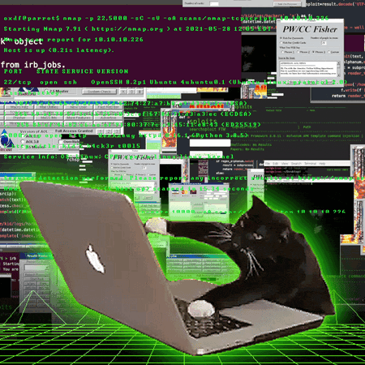

  

  

  

## 🌟 About Me

I am out going with the right people, though I am an introverted person at heart. 
I also enjoy having deep conversations about topics I don't understand yet, and I think of my alone time as a break to recharge for the next interaction.

### Likes 💟

- Reading 💻
- Battle Royales 🎮

## Programming Languages 

- Java ♨️

## Development Tools 🖥️

  
  

## Goals 🎯

- Write clean and understandable code

- Explore different coding languages

- Grow through consistent learning
